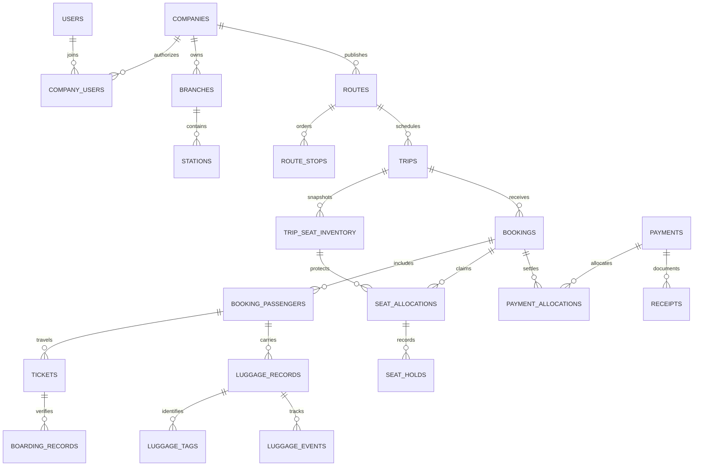

# Database schema and migration status

## Implemented Section 01 objects

PostgreSQL 18. The migration runner creates private `safeer_meta.schema_migrations(version integer PK, name text UNIQUE, checksum text, applied_at timestamptz)`. Migration `0001_foundation.sql` creates the private `safeer` namespace. PUBLIC receives no namespace/ledger access. Section 02 adds identity objects below; company objects are added by Section 03; reservation, financial and registered luggage tables remain deferred.

The passenger prototype still uses memory. Staff access uses the identity service and a limited PostgreSQL runtime login. Native tests use disposable databases; the optional local launcher creates a separate persistent development database under ignored `runtime/`. No school, restaurant or production database is used.

## Implemented Section 02 objects

Migration [0002_identity.sql](../database/migrations/0002_identity.sql) creates eight identity tables: users, sessions, roles, permissions, role_permissions, platform_user_roles, identity_audit and auth_throttles. Users have normalized unique email login, salted scrypt hash, active/temporary-password flags, optimistic version and credential version. Sessions have only token hashes, credential version, absolute expiry, last activity and revocation; idle expiry is checked at request time. No plaintext password or session token is persisted in the database.

Eight built-in role templates and six implemented identity permissions are seeded. Only platform-scope roles can be assigned here: a composite role/scope FK plus a platform-only check rejects company/branch/station/trip assignments. Company memberships/custom company roles/support grants are implemented in Section 03, and later permission catalogs are not seeded as fake working grants.

The global identity mutation advisory lock `(94106,2)` serializes authorization-sensitive changes, with a shared lock for reads. It makes last-active-owner checks and reauthorization atomic across sessions/role changes. Login limits use hashed keys and database reset instants. Identity audit contains UUID actor/target, action and timestamp only; the runtime role cannot update/delete audit records or mutate the permission catalog. This is identity consistency, not a business inventory/tenant isolation implementation.

[runtime-grants.mjs](../database/runtime-grants.mjs) grants only the DML needed by this module. The API refuses superuser/BYPASSRLS or schema-CREATE connections; the local developer launcher uses separate migration-owner and runtime credentials. Section 03 adds RLS for company resources.

The 0.2.1 prototype adds in-memory reservation fields `hasLuggage` (boolean) and `luggageDescription` (trimmed text, required at 1-300 characters when true, empty when false). No SQL migration or luggage record is created. In Section 09 persist the equivalent `has_luggage` / `luggage_description` declaration on each booking passenger, with an invariant enforcing the same rules; existing historical data needs an explicit migration policy. Section 11 registration remains a separate verified record linked to that passenger.

## Implemented Section 03 objects

[0003_companies.sql](../database/migrations/0003_companies.sql) adds companies, company_settings, branches, stations, company_roles, company_role_permissions, company_users, company_user_roles, support_access_grants, support_access_grant_permissions and company_audit (11 new / 19 total application tables).

Company slugs are globally unique; branch/station codes are company-unique. Company settings store hold minutes (5-1440), IANA timezone and language. Companies have pending/approved/suspended/archived state. Members are unique per company/global user and keep a company-local display name and active flag. Up to ten role assignments bind company, branch or station scope, with composite company/member/role/scope/resource FKs and NULLS NOT DISTINCT uniqueness. Stations' (company,branch,id) keys prevent mixing branches in assignments. No trip assignment, city catalog, counter or currency/money table is introduced here.

All eleven tables enable RLS. company_actor validates a raw transaction-local session against hashed sessions, active credentials, first-password change and absolute/idle expiry. company_can/company_has evaluate the current scope, active parent resources and explicit expiring support grants; platform permission names alone do not confer company membership. Security-definer helpers use a fixed pg_catalog path and fully qualified names; execution is revoked from PUBLIC and selectively granted to the non-owner runtime login. No GUC actor ID/company ID/super flag can bypass those checks.

Policies restrict tenant reads/writes and grant ceilings. Immutable-ownership triggers reject transferring existing tenant rows. Deferred last-company-administrator constraints check final transactional state, including global user deactivation, under the shared authorization lock. A capable company administrator retains company-scoped profile/staff/role read and staff/role management permissions. Company audit is append-only for runtime. Only Super Admin changes approval/slug or support grants. Support permissions are restricted by CHECK to profile/resources/audit reads, with maximum 24-hour expiry and reason/approver/history.

Local capacities are enforced by owner-defined insert triggers (serialized with the authorization lock): 200 companies; per company 100 branches, 200 stations, 500 members, 50 roles, 500 support-history rows; 10 assignments/member. Lists are complete within these bounds; audit returns the latest 100 permitted events. Global templates receive the nine new company permissions and version increments to invalidate stale editors; existing user/credential/session rows remain unchanged. Tenant copies only inherit templates at company creation.

## Naming, keys and ownership for future migrations

- UUID surrogate IDs. Each company-owned table has non-null company_id, FK companies(id), and UNIQUE(company_id,id). Child references to private parents use `(company_id,parent_id) -> parent(company_id,id)`; checking only a UUID is insufficient to prevent cross-company links.
- Global identity/catalog rows are explicitly designated below. Passengers/customer history are company-private, even when the same phone appears at several operators. Public projections never expose these tables directly.
- Use timestamptz for instants, a separate IANA timezone for local schedule interpretation, and ordered stop indexes for journey segments. Avoid hard deletion of operational/financial history; explicit status/event records control lifecycle.
- Amounts use bigint minor units, currency_code and immutable exponent/price snapshots. API amounts are integer strings. Quantities/weights use suitable checked integer/numeric fields, not formatted text.
- FK delete defaults are RESTRICT; cascades are allowed only for documented nonhistorical child/config records. Index referencing FK columns and tenant/time access paths. Unique constraints are authoritative, not pre-insert UI checks.

The catalog below remains the full target contract. The eight Section 02 tables listed above are implemented; company-role/membership rows marked 02/03 and Section 03 tables above are implemented; later business tables remain proposed. Their owning sections add migrations, constraints, repositories and authorization/RLS tests before use. Actual Section 02/03 DDL is authoritative where the earlier catalog is abbreviated.

## Complete planned entity catalog

| Owner section | Entity | Important fields and relationships | Keys, constraints and primary indexes |
| --- | --- | --- | --- |
| 02 | users (global identity) | id, normalized_login, password_hash, active, credential_version, created_at | Unique normalized login where applicable; no shared company customer listing |
| 02 | sessions (identity-private) | user_id, token_hash, expires_at, revoked_at, device metadata | Unique token hash; user/expiry index; tokens never plaintext |
| 02 | roles (global built-in templates) | code, scope(platform/company/branch/station/trip), label keys | Unique code; immutable template scope |
| 02 | permissions (global catalog) | code, module, sensitivity | Unique permission code; no caller-defined grants |
| 02 | role_permissions (global templates) | role_id, permission_id | Composite PK; FK to both catalogs |
| 02/03 | company_roles | company_id, template_id optional, code, display_name | Unique(company_id,code); custom definitions stay tenant-owned |
| 02/03 | company_role_permissions | company_id, company_role_id, permission_id | Same-company role FK; unique role/permission pair |
| 02/03 | company_users | company_id, user_id, branch_id/station_id optional, active, employee profile | Unique(company_id,user_id); scoped resource FKs; user index |
| 02/03 | company_user_roles | company_id, company_user_id, company_role_id, resource_scope | Same-company FKs; unique assignment; scope validated against resource owner |
| 02 | platform_user_roles (platform-private) | user_id, role_id, assignment actor/time | Restrict to platform role scope; separate from company membership |
| 03 | companies | id, slug, names, approval_status, active, contact/logo document refs | Unique normalized slug; approval/status index; audit approval changes |
| 03 | company_settings | company_id, hold_seconds, timezone, locale, policy_version | One row per company; positive bounded hold; enabled money catalogs use normalized child rows |
| 03/10 | company_currencies | company_id, currency_code, enabled, is_default | Unique company/currency; global currency FK; at most one enabled default; historical money retains exponent snapshots |
| 10 | company_payment_methods | company_id, method_code, enabled, evidence_policy | Unique company/method; approved method codes; validate current enablement in payment use case without invalidating historical records |
| 03 | branches | company_id, code, names, contact, active | Unique(company_id,code) |
| 03 | stations | company_id, branch_id, city_id, code, names, location, active | Same-company branch FK; unique(company_id,code); city FK |
| 03/10 | counters | company_id, station_id, code, active | Same-company station FK; unique(company_id,station_id,code) |
| 03 | support_access_grants (platform-controlled/private) | company_id, support_user_id, permissions, reason, approved_by, expires_at, revoked_at | Expiry/revocation checks; company/user/time indexes; changes audited |
| 03 | support_access_grant_permissions | company_id, grant_id, permission_id | Same-company grant FK and global permission FK; unique grant/permission; no unvalidated free-form permission list |
| 04 | cities (global approved catalog) | id, canonical_code, name_ar/en, country_code, active | Unique canonical code; localized search indexes as measured |
| 04 | routes | company_id, code, origin_city_id, destination_city_id, active, version | Different endpoints; city FKs; unique(company_id,code,version) |
| 04 | route_stops | company_id, route_id, stop_index, city_id, station_id optional | Unique(company_id,route_id,stop_index); stop order/range checks; same-company station |
| 05 | seat_layouts | company_id, code, version, rows/configuration, immutable_at | Unique(company_id,code,version); prohibit in-place edits once used |
| 05 | seats | company_id, seat_layout_id, label, row/column, class, active | Unique(company_id,seat_layout_id,label); valid positions |
| 05 | buses | company_id, code, registration, bus_category, seat_layout_id, active | Same-company layout; unique company fleet code/registration as approved |
| 05 | drivers | company_id, company_user_id optional, employee_code, required operational details | Same-company employee FK; unique company driver code |
| 06 | trips | company_id, route_id/version, service_date, departure_at, arrival_at, timezone, status, fare/currency snapshot | Valid times; company/departure/status index; published search projection |
| 06 | trip_assignments | company_id, trip_id, bus_id, driver_id, assigned_at, replaced_at, reason | Same-company FKs; one active bus assignment/trip; assignment history preserved |
| 06 | trip_stops | company_id, trip_id, stop_index, source_route_stop_id, city/station/time snapshot | Unique(company_id,trip_id,stop_index); immutable after sales except controlled changes |
| 06/08 | trip_seat_inventory | company_id, trip_id, source_seat_id, seat_label/class snapshot | Unique(company_id,trip_id,seat_label); row is a stable lock anchor, not a cached availability truth |
| 09 | passengers | company_id, full_name, mobile_normalized, optional user link, retention metadata | Company/mobile search index; phone is not universally unique |
| 08/09 | bookings | company_id, trip_id, reference, guest_access_hash, status, expires_at, policy/fare/currency/amount snapshots | Unique reference; unique access hash; company/status/expiry indexes; one owning company/trip |
| 09 | booking_passengers | company_id, booking_id, passenger_id, name/contact snapshot, travel category | Same-company FKs; stable per-traveler identity and document links |
| 08 | seat_allocations | company_id, trip_id, trip_seat_id, booking_id, booking_passenger_id optional, segment int4range, status, expires_at | Active held/confirmed allocations exclude overlapping seat ranges; company/trip/seat index |
| 08 | seat_holds | company_id, booking_id, allocation_id, created_at, expires_at, released_at/reason | Same-company allocation/booking; unique allocation hold; due-expiry partial index |
| 10 | tickets | company_id, booking_id, booking_passenger_id, allocation_id, ticket_number, qr_token_hash, status, issue snapshot | Unique company ticket number and QR hash; one valid ticket per travel allocation; paid-allocation invariant |
| 10 | payments | company_id, booking_id, station/counter/session_id, method, amount_minor, currency/exponent, status, actor, confirmed_at, reversal_of_id | Positive posted amount; same-company/currency invariants; immutable posted records; company/station/time index |
| 10 | payment_allocations | company_id, payment_id, booking_id, amount_minor, currency | Same-company FKs; positive values; totals validated under booking/payment locks |
| 10 | receipts | company_id, payment_id, receipt_number, issued_by, document_id, snapshot | Unique company receipt number; unique original receipt/payment; reprints reference original |
| 10 | refunds | company_id, original_payment_id, amount_minor, reason, actor, approved_by, reversal_movement_id | Positive value; cumulative eligible maximum checked under lock; immutable posted refund |
| 10/13 | cash_sessions | company_id, station_id, counter_id, opened_by/at, opening_minor, closed_by/at, declared/expected totals | Unique active session per company/counter; close cannot precede open; currency policy explicit |
| 10/13 | cash_movements | company_id, session_id, payment/refund/reversal link, direction/type, amount_minor, currency, actor, occurred_at | Same-company FK; unique source movement; immutable after posting; session/time index |
| 10 | document_sequences | company_id, document_type, scope/fiscal_period, next_value | Unique company/type/scope; lock when allocating numbers; no assumed gap-free numbering |
| 11 | luggage_records | company_id, booking_id, booking_passenger_id, ticket_id optional until issued, trip_id, bus snapshot, luggage_number, category, quantity, weight_kg, description, handling, lifecycle_status | Unique company luggage number; same-company and matching passenger/trip validation; checked nonnegative weight/positive quantity |
| 11 | luggage_tags | company_id, luggage_record_id, tag_number, qr_token_hash, document_id, issued_at, replaced_by_id | Unique tag and QR hash; replacements preserve history |
| 11 | luggage_events | company_id, luggage_record_id, prior/new state, event_type, actor, station, time, reason | Append-only transitions; exception/resolution independent of lifecycle; luggage/time index |
| 12 | boarding_records | company_id, trip_id, ticket_id, passenger_id, boarding_station_id, actor, boarded_at, verification result | Unique successful boarding per ticket/journey; authorized assigned trip; scan retries idempotent |
| 12 | trip_events / incidents | company_id, trip_id, type(departure/arrival/completion/incident), actor/time, details | Same-company trip FK; valid lifecycle transitions; incident data access limited |
| 10-14 | documents | company_id, type, owner record link, private object key, content hash, render/version/locale, created_at | Unique object key/hash policy; owner FK via typed association tables; no unvalidated polymorphic orphan IDs |
| 08+ | idempotency_records | company_id, principal/capability_hash, operation, key_hash, request_hash, result record refs, status, expires_at | Unique company/principal/operation/key; atomically tied to operation; retention longer than retry window |
| 08+ | outbox_events | company_id, event_id/type/version, aggregate id, payload, created_at, delivered_at, attempts | Unique event ID; pending/time index; payload excludes unnecessary PII |
| 14 | notifications | company_id, recipient/capability reference, channel, template/version, status, provider id, dedupe key | Same-company recipient ownership; unique dedupe key; retry/time index; no plaintext tokens in logs |
| 02+ | audit_logs | company_id for company events, actor, action, resource id, scoped metadata, request/correlation id, occurred_at | Append-only; company/time and actor/time indexes; no passwords/tokens/full passenger payloads |
| 02+ | platform_audit_logs (platform-private) | actor, action, affected_company_id optional, reason/grant, correlation/time | Separate from company-owned audit; global access explicitly authorized |
| 03/10 | currencies (global configurable catalog) | code, exponent, label keys, active | Unique code, checked exponent; money snapshots prevent later catalog changes rewriting history |

## Relationship overview

Every private relationship above includes the owning company, even where the diagram omits it for readability.

## Seat and payment integrity strategy

One allocation table represents both held and confirmed inventory so overlapping claims are constrained in one place. Planned exclusion: company equality + trip equality + trip-seat equality + overlapping `int4range` for active statuses. The `btree_gist` extension is introduced only with that tested migration in Section 08. Never build an index predicate using `now()` to simulate expiry. Transition expired claims under the same ordered seat locks before allocating replacements; a delayed job cannot block legitimate reassignment forever.

Payment confirmation locks the booking and allocations, reads a fresh database clock after any wait, then validates active ownership and balance. Commit money/allocation/ticket/receipt/cash/audit/outbox records together. Cross-row totals, paid-ticket eligibility and matching passenger/trip links need transactional services and, where suitable, database triggers; a CHECK constraint alone cannot express arbitrary cross-table totals.

## Migration history and policy

| Migration | Executable changes | Owning section |
| --- | --- | --- |
| 0001_foundation.sql | Private safeer namespace; migration runner manages private checksum ledger | 01 |
| 0002_identity.sql | Identity tables, role templates, sessions and audit | 02 |
| 0003_companies.sql | Eleven company tables, scoped access, RLS and administrator guards | 03 |
| Future sequential files | Only the implemented module's reviewed DDL/constraints/indexes/policies | 04 onward |

Use append-only sequential `0001_name.sql` files. The runner normalizes CRLF, hashes contents, checks applied names/versions/checksums, obtains a transaction-level advisory lock, and commits all pending files with their ledger rows atomically. SQL files must not contain their own transaction control or nontransactional statements. Drift/unknown history fails closed. No automatic down-migrations or edits to applied files; use reviewed forward corrections. Keep schema-owner and application credentials separate.

See [database operations](database/MIGRATIONS.md) for local commands, test setup, upgrade/backfill and recovery requirements.

## 0.3.1 - Super Administrator role editing

Owner-authorized D20 follow-up: Super Administrators can edit names, permissions and status of all eight built-in role templates and custom platform roles. Reserved owner codes/scopes remain immutable, owner authority always includes the permission catalog, and disabling the last active owner is rejected atomically. Other administrators remain restricted. Company/resource assignment remains deferred to Section 03; no schema migration or company access is added. The role editor supports Arabic/English and mobile layouts.

## 0.3.2 - Connected workspace layout

No schema or grants change in this layout update. User-role names are resolved from the existing authorized roles endpoint. Search filters the currently loaded page only; it does not imply a global user search.

## 0.3.3 - Skeuomorphic styling (2026-10-31)

No database, migration, grants or stored data changes. All material styling is CSS-only.

## 0.3.4 - Dark mode (2026-10-31)

No schema, grants or runtime records change. Only the non-sensitive theme preference (safeer.theme: dark/light) is persisted in browser local storage, with a blocked-storage fallback.
