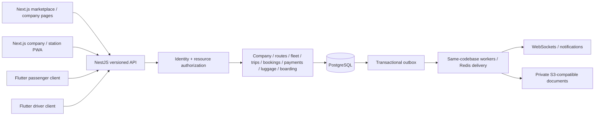

# System architecture

## Present executable architecture

`server.mjs` binds to loopback, serves an explicit asset allowlist and exposes `GET /api/v1/health`. The health response describes a **local prototype**, not production readiness or a database connection. `src/` contains the retained passenger demo, separate translations, shared visual tokens and pure in-memory example rules. The PostgreSQL migration CLI is an independent developer tool and is never exposed as an HTTP endpoint. The web process does not connect to PostgreSQL in this section.

The old freight prototype was archived before removal. The current browser's demo company selector, in-memory inventory and name-only single-seat booking must never be reused as production authorization or concurrency control.

0.2.1 adds a luggage declaration to the in-memory passenger reservation. Form constraints and the domain function both validate it; outputs are escaped as plain text in lists and references. It changes no service/database boundary and implements no station registration, fees or tracking.

## Target modular monolith

These services are **planned**, not running. Start with one backend codebase and database; a separately running worker may use the same modules. No microservices or independent financial databases are required. Cache misses, delayed jobs and WebSocket disconnects must not compromise database correctness.

## Frontends and shared contracts

The web client uses route areas for public marketplace/company pages, authenticated company operations, station work and platform administration. Access controls belong on server operations, not menu visibility. Shared components cover layout, tables, forms, statuses, localized money/time, errors/loading, confirmation dialogs and print views.

The proposed Flutter clients use Dart UI and generated API models. Root `src/contracts/` is the versioned contract source; shared terminology/design tokens remain in this repository. JavaScript UI reuse is not promised across Flutter. Each client uses an explicit adapter to the same backend contract; no mobile copy of the seat/payment authority exists.

## Backend boundaries and conventions

- Domain layer: state transitions and invariants; no HTTP, UI or provider-specific code.
- Application layer: use cases, permission/resource-scope checks, transaction orchestration and idempotency.
- Infrastructure layer: PostgreSQL repositories, outbox, Redis, document storage and notification adapters.
- Delivery layer: validated versioned DTOs/controllers/WebSocket gateways and worker handlers.
- A module may call another module's exported service or consume its event. It may not directly mutate another module's tables.
- Database money uses integer minor units plus currency/exponent snapshots; API amounts are decimal integer strings. Display formatting is locale-specific; accounting is not performed with JavaScript floating point.
- Store instants as timestamptz/UTC; retain the trip's IANA timezone. Server/database time is authoritative.
- snake_case tables/columns, UUID identifiers, camelCase API fields, typed DTOs, explicit status machines. Never use a phone or sequential reference as an access token.

## Isolation and data flow

Authenticate a principal -> resolve membership and branch/station/assigned-trip scope -> authorize permission -> begin a short database transaction -> establish server-owned tenant context -> execute scoped queries/constraints -> commit state and outbox/audit events together. Connection-pool context uses transaction-local settings, so it cannot leak between tenants.

RLS is defense in depth: runtime roles must not own tables or have BYPASSRLS. Migrations use a separate owner role. Public marketplace queries use a deliberately limited approved/published projection; support and platform administration use separate explicit authorization paths. See [access controls](security/ACCESS_CONTROL.md).

## Background work and real time

The expiry worker processes due holds in bounded batches and may use SKIP LOCKED. Every reservation and payment use case also checks expiry under lock. Events are created in the same transaction as the business state; delivery is at least once and consumers are idempotent. WebSockets announce changes and prompt re-fetch; no seat is sold from an event/cache snapshot alone. Notification/document failures retry after commit and cannot duplicate a payment or invalidate a correctly recorded transaction.

## Storage and operations

Use private object keys bound to company/document records, purpose-limited short-lived access links and immutable ticket/receipt snapshots. Never put passenger details in public buckets, QR payloads, URL logs or analytics events. Database backups and restore drills, secret management, HTTPS, monitoring and deployment readiness belong to their owning sections and the final audit. No production hosting or external account has been configured.

## Technical references checked for Section 01

- [Next.js installation requirements](https://nextjs.org/docs/app/getting-started/installation) and [NestJS first steps](https://docs.nestjs.com/first-steps): Node 24 is suitable for the selected target frameworks; their actual packages will be pinned when introduced.
- [PostgreSQL 18 row security](https://www.postgresql.org/docs/18/ddl-rowsecurity.html): ownership/BYPASSRLS caveats determine the separate runtime/migration-role design.
- [PostgreSQL 18 range types](https://www.postgresql.org/docs/18/rangetypes.html): ordered stop ranges support non-overlap allocation constraints.
- [node-postgres transactions](https://node-postgres.com/features/transactions): each migration transaction uses one client connection.
- [Flutter architecture guidance](https://docs.flutter.dev/app-architecture): client presentation/data responsibilities stay separated from backend business authority.
