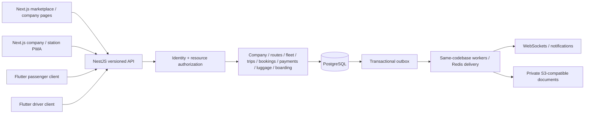

# System architecture

## Floating header curve and glass - D49

Headers now leave 12px desktop/10px mobile top clearance, retained while sticky, so the full rounded edge is visible. Softer tint, broad reflections, brighter edges and layered shadows refine the glass; scroll clearance includes the gap. Above-sidebar controls, bilingual layout and accessibility remain. No schema/API, authority, account, money or native change. See [D49 handover](archive/FLOATING_HEADER_2026-11-05.md); earlier evidence is historical.

## Toggle above the sidebar - D48

The circular button now sits in its own toolbar above the staff/preview sidebar, outside header actions. When collapsed it stays in the leading top corner, with reserved header space for safe restoration. Saved preference, keyboard/ARIA and responsive RTL/LTR behavior remain. No schema/API, authority, business data or native change. See [D48 handover](archive/SIDEBAR_POSITION_2026-11-05.md); older evidence below is historical.

## Circular sidebar button - D47

The header sidebar toggle follows the supplied reference: circular glass, small two-line menu icon and no visible text. A 44px target, translated accessible name/title and all saved hide/restore behavior remain. No API, schema, account, permission, money or native change. See [D47 handover](archive/CIRCULAR_SIDEBAR_2026-11-04.md); prior evidence below is historical.

## Marketplace announcement - D46

The public notice is now a compact aligned glass announcement with an SVG icon, translated Travel update label and wrapping message. Existing protected bilingual settings and plain-text escaping remain. No schema, API, account, permission, financial or native-code change. Read [D46 handover](archive/MARKETPLACE_NOTICE_2026-11-04.md) for verification/checkpoint details; prior evidence below is historical.

## Frosted reference glass - D45

The supplied visual reference guides clearer translucent headers/sidebar, pill controls and frosted summary tiles over warm ambient gradients. Black/brown identity, readable operational panels, sticky headers and the saved sidebar toggle remain. No schema, API, authority, account, money or native-package change. See [D45 handover](archive/REFERENCE_GLASS_2026-11-04.md) for verification and the local checkpoint; prior evidence below is historical.

## Sidebar visibility - D44

A header button hides/restores the staff and fictional-preview sidebars, expanding the workspace without re-rendering forms. A device-local preference survives navigation/reload; Arabic/English labels, keyboard operation and hidden-navigation focus are supported. No API, schema, authority, money, account or native package change. Read [D44 handover](archive/SIDEBAR_TOGGLE_2026-11-04.md) for verification and the local source checkpoint. Earlier evidence below is historical.

## Sticky liquid-glass headers - 2026-11-04 (D43)

D43 keeps staff, Driver, Booking/marketplace and preview headers at the viewport top on scroll, using Apple-inspired layered glass within the black/brown palette. Actual header height protects scrolled form fields; no schema/API, business, account or native package change. Targeted scrolling (64 combinations) and Identity/modal (60) checks pass. See [header evidence](archive/STICKY_HEADERS_2026-11-04.md); earlier entries are historical.

## Black and brown - 2026-11-04 (D42)

D42 changes the current visual palette to black/espresso and brown, with cream/brown light mode, retaining the bento/glass layout, language support, business rules and schema/API. Matching Android shell/icon patches 0.16.0-usb.2 are installed locally. Targeted browser/build/native evidence and limitations are in [the palette handover](archive/BLACK_BROWN_2026-11-04.md). Earlier entries are historical.

## Bento grid and liquid glass - 2026-11-04 (D41)

The verified shared UI refresh adds bento tiles and glass controls/headers/sidebar in both themes and languages, including the existing USB Android web clients. No migration, API, company/driver authority, money policy or native package changes. Nine built-browser workflows, 256 layout/language/theme combinations plus the preview, accessibility preferences and actual phone screens are verified. Read [D41 handover](archive/BENTO_GLASS_2026-11-04.md) and [current state](CURRENT_STATE.md); earlier section entries are historical.

## Android USB follow-up - 2026-11-04 (D40)

Add and install separate local-test Safeer Driver/Booking Android WebView apps over the existing shared src/ and loopback API through USB reverse port 4320. All company, driver assignment, session and offline-payment rules remain unchanged; no schema/API authority changes, account seeding, camera/offline queue, Flutter or hosted release. See [USB installation evidence](archive/ANDROID_USB_2026-11-04.md) and [mobile setup](../mobile/README.md). Earlier section entries below are historical.

## Section 15 - 2026-11-04 (D39)

Add a source-reviewed security manifest consumed by verifyDatabaseSecurity at startup, replacing partial RLS/function checks. The modular local NestJS/PostgreSQL stack is unchanged. Expiry/retention workers share active promises and expose only state/last-success health; both HTTP servers use bounded resource settings. The offline release runner creates a protected disposable PostgreSQL cluster, runs all native and selected source/built browser workflows, records evidence and clean-stops/guards cleanup. It never accesses runtime/ or deploys. See [security review](security/SECTION_15_REVIEW.md), [release operations](RELEASE_READINESS.md) and [Section 15](archive/SECTION_15_RELEASE.md).

## Section 14 architecture (D38)

PlatformService and fixed PostgreSQL projections add global aggregates/notice management behind reserved Super Administrator checks. Notification capture occurs inside existing source transactions through six database triggers; a shared metadata event feed and per-user read receipts form the durable local delivery mechanism. Actor context derives from the validated session token and current database authority. No caller-supplied user/company/admin flag authorizes global reporting or delivery. Runtime receives six function grants without access to new raw tables or internal trigger/visibility helpers. The shared bilingual staff/driver/public src/ uses same-origin request/refresh delivery. No Redis/WebSocket worker or external notification service is introduced. [Platform workflow](workflows/PLATFORM_ADMINISTRATION.md) documents refresh and retention boundaries.

## Section 13 — 2026-11-03 (D37)

Section 13 is complete. Safeer runs locally at 0.14.0 with all thirteen migrations applied. All 118 automated checks passed (15 unit/server and 103 native PostgreSQL), including scoped read-only financial access and a 20,002-movement pagination/export-limit fixture. Source and built Finance browser workflows passed 16 layouts each. The private backup matched 1532 files and passed a protected restore/start/stop check; the existing account, settings and 49 legacy tables passed integrity comparisons. Existing financial rules are unchanged. See [financial reports](workflows/FINANCIAL_REPORTS.md) and [Section 13](archive/SECTION_13_FINANCE.md). Stop before Section 14.

## Historical Section 12 checkpoint — 2026-11-03 (D36)

Section 12 is complete. The local app runs 0.13.0 with all twelve migrations applied and the original account/settings preserved. It adds the owner-approved responsive driver workspace, assigned-trip manifests, printed ticket QRs, separate verification/boarding, journey events and incidents. All 109 automated checks passed (13 unit/server and 96 native PostgreSQL). Source and built driver workflows passed 32 language/theme/viewport combinations; the built station regression passed another 32. The private backup matched 1512 files, passed a protected restore/start/stop check, and the upgraded account/credentials/settings and 45 legacy tables passed integrity comparisons. Flutter remains deferred. See [driver workflow](workflows/DRIVER_BOARDING.md) and [Section 12](archive/SECTION_12_BOARDING.md). Stop before Section 13. Earlier per-section entries retain historical results.

## Historical local upgrade (D34)

At that checkpoint, the local launcher ran the completed 0.12.0 source with migrations 0001-0011. The owner-approved backup matched every copied file and an isolated restore was started and stopped before upgrade. Restore checks inherit private ACLs before data is copied; linked paths are rejected and resolved temporary paths are verified before cleanup. A failed restore stop retains its copy. Credentials and runtime backups remain outside source archives. HTTP remains loopback-only; no production deployment occurred.

## Section 04 route planning

RouteService and its versioned controller extend the existing NestJS modular backend. src/routes.js shares existing staff authentication, dialogs, translations and themes for catalog and route editing. Company workspaces fetch permitted route summaries, then details on demand. City catalog and station-city options connect the two modules. Three new tables use server/database constraints and RLS; route and resource writes share the authorization lock. Atomic route/stop replacement validates deferred constraints before audit/commit. Cities are global; company routes never become public through these endpoints.

## Present executable architecture

Section 02 adds `apps/api/src/`, compiled to `dist/api/`: a NestJS 12.3.2/TypeScript 6.0.3 modular identity backend, PostgreSQL repositories, password/session primitives and versioned HTTP controllers. `/staff` is a working bilingual staff UI; the existing server proxies `/api/v1/` to the explicitly configured loopback API. Cookies stay same-origin. No backend credentials or service source files enter the public asset allowlist.

`npm run local` builds both parts, starts a private local PostgreSQL development cluster on Windows, applies the reviewed migration history using its owner, grants the separate runtime role, and runs the identity API/web server. Runtime data/credentials and first-login details stay under ignored, access-restricted `runtime/`. The API refuses elevated/DDL-capable DB credentials. Normal PostgreSQL installations can use the manual setup documented in [IDENTITY_SETUP](database/IDENTITY_SETUP.md).

The paragraphs describing Section 01 below apply to `npm start` without an identity API configured and to the separate fictional passenger example; they do not describe the new staff route.

`server.mjs` binds to loopback, serves an explicit asset allowlist and exposes `GET /api/v1/health`. The health response describes a **local prototype**, not production readiness or a database connection. `src/` contains the retained passenger demo, separate translations, shared visual tokens and pure in-memory example rules. The PostgreSQL migration CLI is an independent developer tool and is never exposed as an HTTP endpoint. The web process does not connect to PostgreSQL in this section.

The old freight prototype was archived before removal. The current browser's demo company selector, in-memory inventory and name-only single-seat booking must never be reused as production authorization or concurrency control.

0.2.1 adds a luggage declaration to the in-memory passenger reservation. Form constraints and the domain function both validate it; outputs are escaped as plain text in lists and references. It changes no service/database boundary and implements no station registration, fees or tracking.

## Target modular monolith

Identity and company-access modules are implemented; later business modules, Next.js, Flutter, Redis workers, S3 and notifications remain planned. Start with one backend codebase and database; a separately running worker may use the same modules. No microservices or independent financial databases are required. Cache misses, delayed jobs and WebSocket disconnects must not compromise database correctness.

## Frontends and shared contracts

The web client uses route areas for public marketplace/company pages, authenticated company operations, station work and platform administration. Access controls belong on server operations, not menu visibility. Shared components cover layout, tables, forms, statuses, localized money/time, errors/loading, confirmation dialogs and print views.

The proposed Flutter clients use Dart UI and generated API models. Root `src/contracts/` is the versioned contract source; shared terminology/design tokens remain in this repository. JavaScript UI reuse is not promised across Flutter. Each client uses an explicit adapter to the same backend contract; no mobile copy of the seat/payment authority exists.

## Backend boundaries and conventions

- Domain layer: state transitions and invariants; no HTTP, UI or provider-specific code.
- Application layer: use cases, permission/resource-scope checks, transaction orchestration and idempotency.
- Infrastructure layer: PostgreSQL repositories, outbox, Redis, document storage and notification adapters.
- Delivery layer: validated versioned DTOs/controllers/WebSocket gateways and worker handlers.
- A module may call another module's exported service or consume its event. It may not directly mutate another module's tables.
- Database money uses integer minor units plus currency/exponent snapshots; API amounts are decimal integer strings. Display formatting is locale-specific; accounting is not performed with JavaScript floating point.
- Store instants as timestamptz/UTC; retain the trip's IANA timezone. Server/database time is authoritative.
- snake_case tables/columns, UUID identifiers, camelCase API fields, typed DTOs, explicit status machines. Never use a phone or sequential reference as an access token.

## Isolation and data flow

Authenticate a principal -> resolve membership and branch/station/assigned-trip scope -> authorize permission -> begin a short database transaction -> establish server-owned tenant context -> execute scoped queries/constraints -> commit state and outbox/audit events together. Connection-pool context uses transaction-local settings, so it cannot leak between tenants.

RLS is defense in depth: runtime roles must not own tables or have BYPASSRLS. Migrations use a separate owner role. Public marketplace queries use a deliberately limited approved/published projection; support and platform administration use separate explicit authorization paths. See [access controls](security/ACCESS_CONTROL.md).

## Background work and real time

The expiry worker processes due holds in bounded batches and may use SKIP LOCKED. Every reservation and payment use case also checks expiry under lock. Events are created in the same transaction as the business state; delivery is at least once and consumers are idempotent. WebSockets announce changes and prompt re-fetch; no seat is sold from an event/cache snapshot alone. Notification/document failures retry after commit and cannot duplicate a payment or invalidate a correctly recorded transaction.

## Storage and operations

Use private object keys bound to company/document records, purpose-limited short-lived access links and immutable ticket/receipt snapshots. Never put passenger details in public buckets, QR payloads, URL logs or analytics events. Database backups and restore drills, secret management, HTTPS, monitoring and deployment readiness belong to their owning sections and the final audit. No production hosting or external account has been configured.

## Technical references checked for Section 01

- [Next.js installation requirements](https://nextjs.org/docs/app/getting-started/installation) and [NestJS first steps](https://docs.nestjs.com/first-steps): Node 24 is suitable for the selected target frameworks; their actual packages will be pinned when introduced.
- [PostgreSQL 18 row security](https://www.postgresql.org/docs/18/ddl-rowsecurity.html): ownership/BYPASSRLS caveats determine the separate runtime/migration-role design.
- [PostgreSQL 18 range types](https://www.postgresql.org/docs/18/rangetypes.html): ordered stop ranges support non-overlap allocation constraints.
- [node-postgres transactions](https://node-postgres.com/features/transactions): each migration transaction uses one client connection.
- [Flutter architecture guidance](https://docs.flutter.dev/app-architecture): client presentation/data responsibilities stay separated from backend business authority.

## 0.3.1 - Super Administrator role editing

Owner-authorized D20 follow-up: Super Administrators can edit names, permissions and status of all eight built-in role templates and custom platform roles. Reserved owner codes/scopes remain immutable, owner authority always includes the permission catalog, and disabling the last active owner is rejected atomically. Other administrators remain restricted. Company/resource assignment remains deferred to Section 03; no schema migration or company access is added. The role editor supports Arabic/English and mobile layouts.

## 0.3.2 - Connected workspace layout

The staff shell in src/staff.js and src/staff.css provides a responsive sidebar, account overview, filters and cross-screen actions. Users resolve assigned role labels through the existing permission-checked API. Staff/passenger URLs preserve only the selected language via ?lang=en or ?lang=ar; no credentials or authorization state are put in URLs.

## 0.3.3 - Skeuomorphic styling (2026-10-31)

Shared material tokens in src/tokens.css define paper, enamel, navy texture and raised/inset shadows. Staff and passenger styles consume those materials without images, remote resources, new dependencies or behavior changes.

## 0.3.4 - Dark mode (2026-10-31)

Shared src/theme.js initializes dark mode by default, handles delegated theme switching without re-rendering forms, persists a validated preference, and listens for same-origin storage updates. Shared src/theme.css styles both interfaces and isolates dark materials to screen media. Both HTML entry points load the theme stylesheet; the public asset allowlist/build now contains 14 files.

## Section 03 executable boundary

`CompanyService` and company controllers reuse the authenticated identity transaction, current-password/CSRF validation and shared advisory lock. The server sets the raw opaque session capability with transaction-local set_config; fixed-search-path SQL helpers resolve the active actor, memberships, scoped permissions and read-only support grants. RLS applies to all eleven tenant tables, in addition to explicit company predicates and composite FKs. Local context expires with the transaction and cannot be replaced by caller actor/company IDs. Runtime connections are non-owner/non-BYPASSRLS; startup requires the expected RLS tables. Definer functions are owned by the migration owner and have no PUBLIC execution.

The shared staff shell loads `src/companies.js`; real company screens are separate from the fictional in-memory passenger example. The build contains 15 public allowlisted files. Future city relationships, trip scopes, money/catalogs and booking integration are deferred to their owning modules. No service source or runtime backup enters the static build.

## Section 05 fleet

FleetService and its versioned controller extend the existing NestJS modular backend. src/fleet.js shares existing staff authentication, dialogs, translations and themes. Company workspaces fetch fleet and driver data only when their company-wide capabilities allow it. Seat maps render left-to-right in both languages because they show the physical bus.

## Section 06 trips

TripService and its versioned controller extend the existing NestJS modular backend. src/trips.js shares existing staff authentication, dialogs, translations and themes. Snapshots are filled by database triggers, not the API, so no client can forge them.

## Section 07 marketplace

PublicService serves anonymous reads through fixed SECURITY DEFINER projections, each naming its output fields; the runtime role still cannot read the underlying rows without a session. marketplace.html and src/marketplace.js are one static page serving /marketplace and /company/{slug}, separate from staff code and the fictional prototype at /. This supersedes nothing in the target Next.js plan: it is the local implementation until hosting is authorized.

## Section 08 seat holds

ReservationService exposes anonymous holds and staff seat views through fixed SECURITY DEFINER functions; the runtime role has no access to the tables. public_hold locks the trip row, which serializes claims per trip without a global lock, and a GiST exclusion constraint over company, trip, seat and stop range is the final guarantee. A 30-second in-process job closes lapsed holds, but no decision depends on it. marketplace.html serves /trip/{id} and /hold/{reference} as well as the search and company pages. Hold writes are the first without a session, so the API middleware exempts exactly those paths from CSRF while still requiring the page origin and JSON.

## Section 09 passengers

Personal details live in booking_contacts and booking_passengers so they can be erased while bookings, allocations and events stay. public_book wraps public_hold and inserts details in the same transaction. An hourly in-process job erases what is due in short batches. The browser stores only the hold key, never names or numbers, and the Bookings staff section loads details only when opened.

## Section 10 ticketing

The Station section and booking sheets call a TicketingController backed by fixed database functions; the runtime role has no table access. Each payment or sale is one transaction, repeats return the original through a key bound to the company and purpose, and the trip row lock serializes seat changes. Document numbers come from per-company sequences that commit with the document. Printing uses the browser print dialog with print-only styles in src/staff.css.

## Section 11 luggage

The Luggage section calls a LuggageController backed by fixed database functions; the runtime role has no table access. The QR is built in the API from a random value, returned once as a vector path, and only its hash is stored. A hardware scanner types into the search box, and the scan goes in a request body so it stays out of logs. Registering takes the same trip lock as refunds, so a bag cannot slip in during a refund. qrcode-generator is a new runtime dependency; jsqr is used only by tests.
